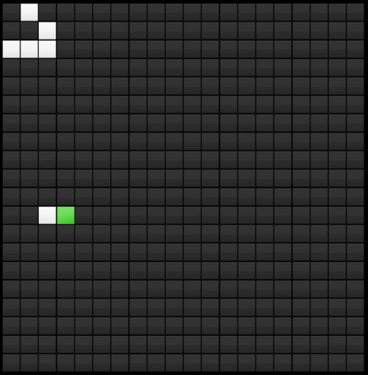
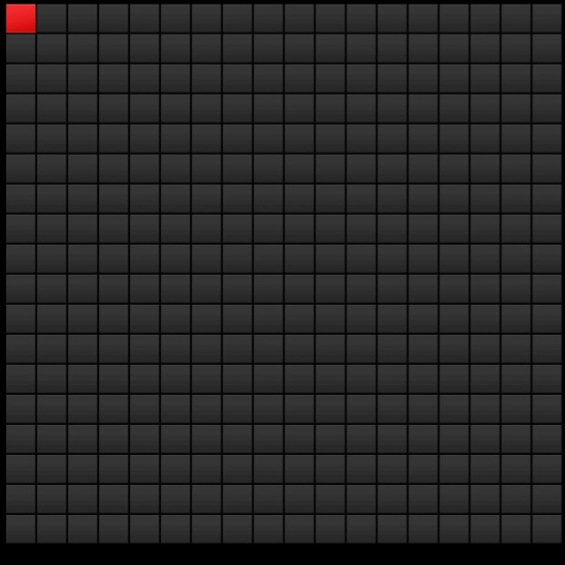
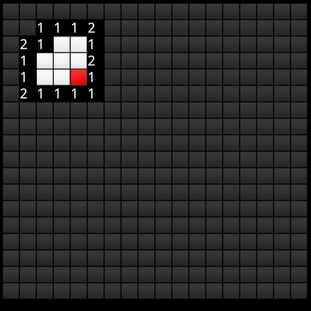
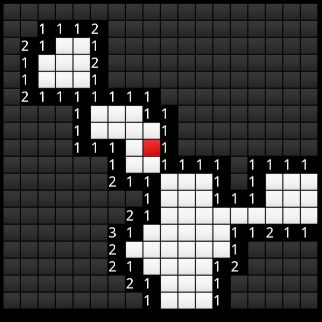
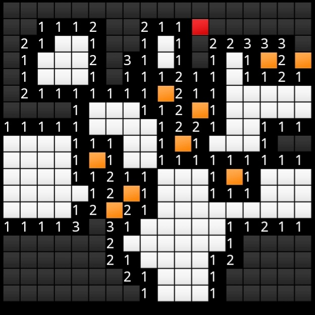
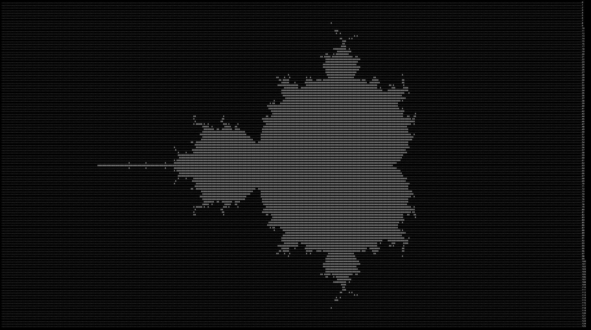
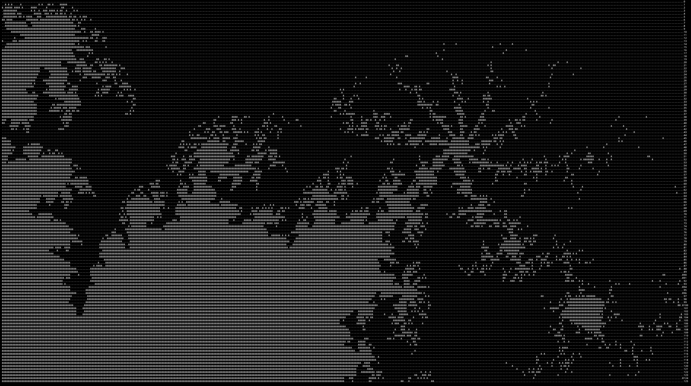
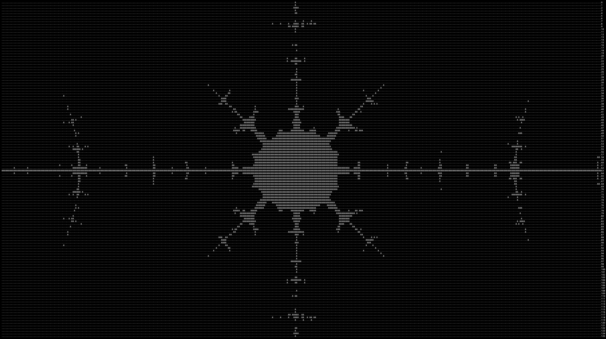
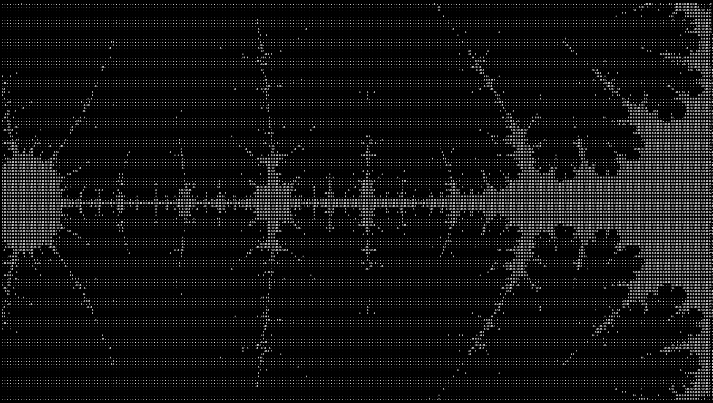
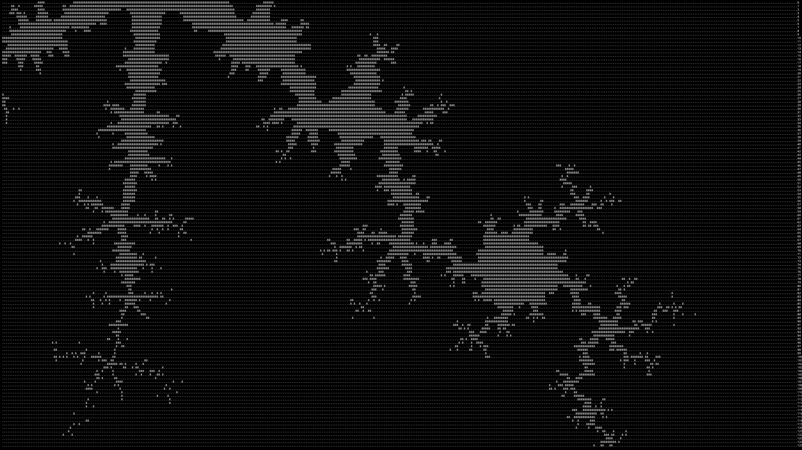

# Java Algorithm & Games!

A collection of small Java programs exploring prime generation, cellular automata, numerical sequences, and Minesweeper.  
Most of this projects were written several years ago as independect learing exercise. I am collecting them here to document my early experiments with algorithmic programming, before I started using coding agents.

## Projects:

### primes

- I was thinking of a way to find primes algorithmically without looking out existing answers. After a lot of thinking and trial and error I managed to reinvented the Sieve of Eratosthenes.
- With further improvements I managed to make program that can find millions of primes in a matter of seconds (100 million limit avereges 3.84 million prime/second with writing to a file and 8.22 without writing to a file on a snapdragon 865+).

#### Usage

- Run with `java primes.java [optional search limit]`
- The programm takes an input argument and searches for all primes from 2 to the given number.
- If no argument is given the programm will search for primes up interger.MAX_VALUE-2.
- On line 8 of the code there is a boolean flag that can be set to true to write all found primes to a file called `primes.txt` in the root directory of the project.
- Runs with a high inputs need an increased jvm heap size. This can be done by adding the following argument to the Java command: -Xmx[size]. for the 'integerlimit', 3gb are recommended. For example: `java -Xmx3g primes.java`

### game-of-life

- This is a implementation of the famous cellular automaton "Conway's Game of Life".
- Upon running, the game asks for the size of the grid and the number of iterations (simulation steps). After that, the game starts in editing mode, where a 'player' can move with w a s d and place and remove live cells with e. The simulation starts when q in entered.
- As an example, the grid is generated with a pattern called 'glider' which moves diagonally across the grid.

### cli-Minesweeper

This here is a simple cli game, a recreation of the famous Minesweeper

   

#### Controls

- Movement: w, a, s, d
- Reveal cell: e
- Place flag: f

- Every input need to be confirmed by an 'enter'

### gui-Minesweeper

- This is another (older) implementation of a Minesweeper game, but this time with a gui. The gui is made with the Java AWT library.
- The graphical implementation is a bit unconventional as i was more interested in the algorithmic part of the game than the graphical part. So at the time I only learned how to draw a rectangle using the object 'Label' and used it as a building block to everything as a combination of rectangles (including the numbers).

#### Controls

- To run the game: `javac Main.java && java Main`
- Movement: arrow keys
- Right-click (open a field): e
- Left-click (place a flag): f
- Reveal all fields: enter

### mandelbrot

- This programm draws an interactive Mandelbrot fractal in the terminal.

#### Usage

- Run with `java mandelbrot.java [optional scale (default 4)]`
- controls (must be confirmed with 'enter'):
  - w, a, s, d: move the view
  - e, q: zoom in and out
  - r, f: increase and decrease the iteration limit

### racamans
- This programm walks through the Recamán sequence up the the integer.MAX_VALUE-2 and prints every 'holdout' (smallest number that has not been seen yet) and the step at which they were found.

#### Usage
- Unlike the primes programm, this programm does not take any input arguments. It will just run until it reaches the integer.MAX_VALUE-2. That means it will always need to be run with an increased jvm heap size. This can be done by adding the following argument to the java command: -Xmx3g.

